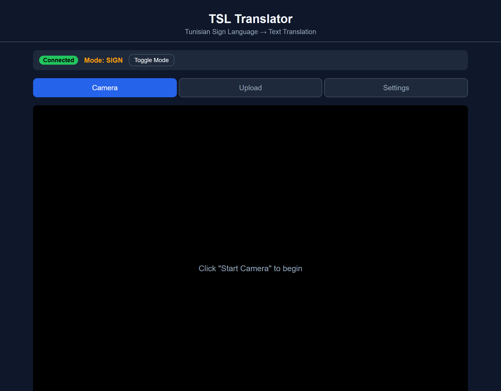
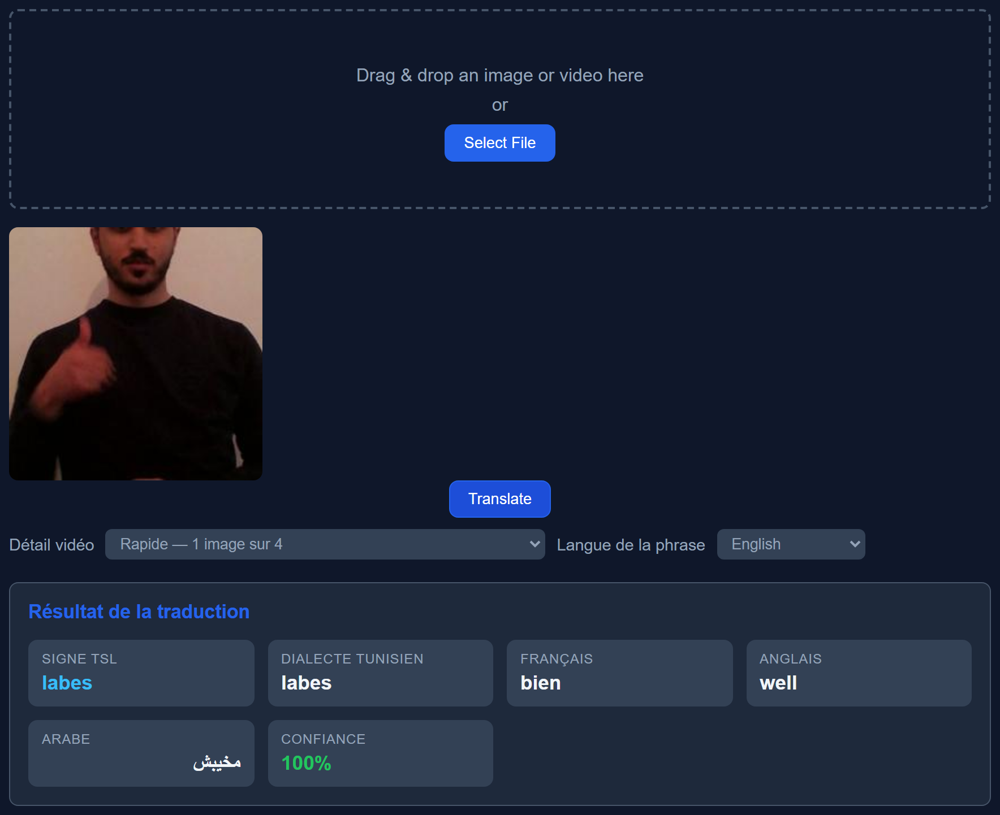
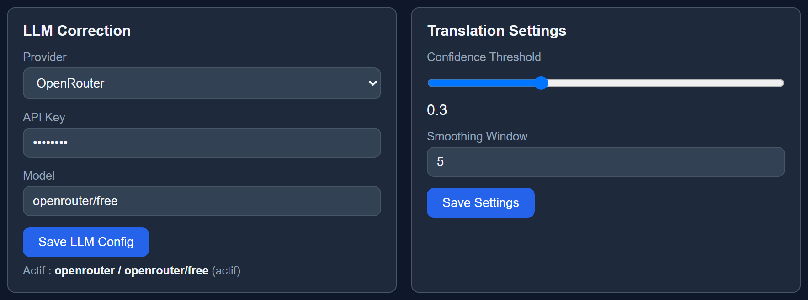
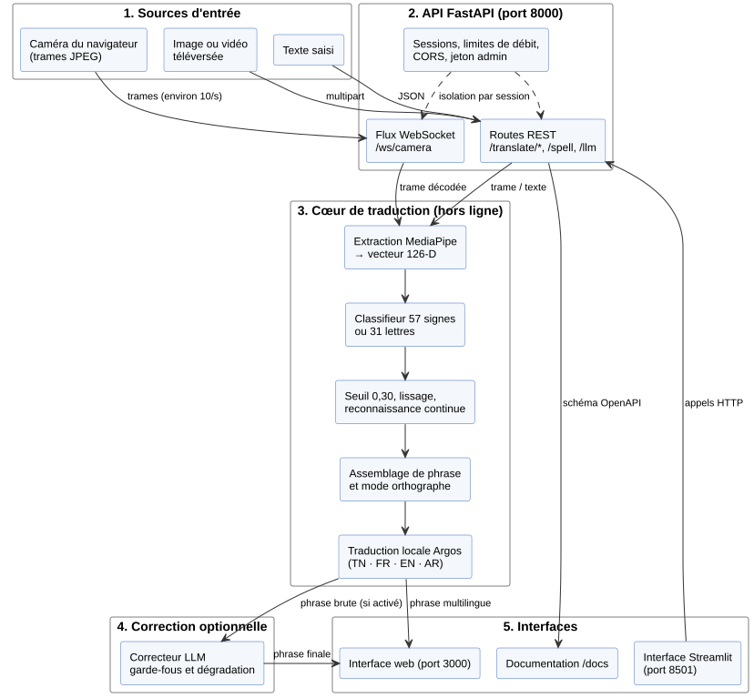

# 🇹🇳 Tunisian Sign Language Translator (TSL)

[](https://www.python.org/downloads/)
[](#-tests)
[](LICENSE)

**Une application qui traduit la langue des signes tunisienne (TSL) en texte.**

On montre un signe à la caméra, sur une photo ou dans une vidéo → l'application le reconnaît et le
traduit en **dialecte tunisien, français, anglais et arabe**, sans connexion internet pour la
reconnaissance ni pour la traduction.

| | |
|---|---|
| 📷 **Caméra temps réel** | flux vidéo traité image par image via WebSocket |
| 🖼️ **Image** | photo ou glisser-déposer → traduction immédiate |
| 🎬 **Vidéo** | signes enchaînés → phrase assemblée puis traduite |
| ⌨️ **Mode orthographe** | finger spelling : épeler un mot lettre par lettre (31 symboles) |
| 🌍 **4 langues** | tunisien, français, anglais, arabe (std. + dialectal) |
| 🤖 **Correction de phrase** | optionnelle, via un LLM (OpenRouter, Ollama, LM Studio…) |

---

## 📸 Aperçu

| Caméra | Traduction d'une image |
|---|---|
|  |  |

| Réglages |
|---|
|  |

---

## ✨ Fonctionnalités

- **Reconnaissance de 57 signes TSL** répartis en 5 catégories :

  | Catégorie | Signes |
  |---|---|
  | Demandes | 24 |
  | Famille | 12 |
  | Destinations | 8 |
  | Jours | 7 |
  | Transport | 6 |

- **Finger spelling** : les 28 lettres de l'alphabet arabe + *espace*, *retour* et *fin* (31 classes).
- **Deux modes commutables** en direct : `SIGN` (reconnaissance de signes) ↔ `SPELL` (orthographe),
  avec un signe dédié pour entrer et sortir du mode.
- **Assemblage en phrase** : lissage temporel, détection des pauses et reconstitution des mots
  à partir d'une séquence d'images.
- **Traduction hors ligne** du texte via [Argos Translate](https://www.argosopentech.com/) —
  aucun appel réseau à l'inférence.
- **Correction / reconstruction de phrase par LLM**, entièrement optionnelle : si le LLM est
  absent ou en erreur, la phrase brute est retournée telle quelle.
- **API REST complète** avec documentation interactive (`/docs`) et **WebSocket** pour la caméra.
- **Historique isolé par client** (en-tête `X-Session-Id`), seuil de confiance et fenêtre de
  lissage réglables à chaud.

---

## 🧠 Comment ça marche ?

```
Caméra / Image / Vidéo
        │
        ▼
MediaPipe Hand Landmarker détecte les mains (21 points × 2 mains → 126 valeurs)
        │
        ▼
Réseau de neurones (MLP résiduel, 57 sorties) reconnaît le signe
        │
        ▼
Lissage temporel + assemblage en phrase
        │
        ▼
Dictionnaire TSL → tunisien / français / anglais / arabe
   (+ correction optionnelle par LLM)
        │
        ▼
Résultat affiché dans l'interface ou renvoyé par l'API
```

---

## 🛠️ Technologies

| Couche | Outils |
|---|---|
| **Langage** | Python 3.10+ (testé sur 3.12) |
| **Détection des mains** | [MediaPipe](https://mediapipe.dev/) Hand Landmarker |
| **Modèles** | PyTorch — MLP résiduel (57 signes) + classifieur d'alphabet (31 classes) |
| **API** | FastAPI + Uvicorn (REST + WebSocket) |
| **Interface web** | HTML / CSS / JavaScript (statique, temps réel via WebSocket) |
| **Interface alternative** | Streamlit |
| **Traduction hors ligne** | Argos Translate |
| **Correction optionnelle** | Tout fournisseur compatible OpenAI (OpenRouter, Ollama, LM Studio…) |
| **Empaquetage** | Docker + Docker Compose |
| **Tests** | pytest |

---

## 🏗️ Architecture



| Composant | Rôle |
|---|---|
| `api/` | serveur FastAPI : routes REST, WebSocket caméra, sessions, limites d'upload |
| `web/` | interface utilisateur (statique `index.html` / `app.js` / `style.css`, et Streamlit `app.py`) |
| `src/translation/` | cœur de la traduction : pipeline, lissage, assemblage, mode, correction LLM |
| `src/models/` | extraction des landmarks, classifieur de signes, classifieur d'alphabet, entraînement |
| `src/languages/` | dictionnaire TSL et alphabet |
| `src/config/` | paramètres et chemins |
| `models/` | poids entraînés + modèle MediaPipe |
| `data/` | dataset et jeux de données préparés |

---

## 🚀 Installation

```bash
git clone https://github.com/MaherAbderrahim/Tunisian-Sign-Language-Translator.git
cd Tunisian-Sign-Language-Translator

python -m venv venv
venv\Scripts\activate        # Windows
source venv/bin/activate     # Linux / Mac

pip install -r requirements.txt
```

Puis créez votre fichier de configuration :

```bash
copy .env.example .env       # Windows
cp .env.example .env         # Linux / Mac
```

> L'application fonctionne **sans clé API** : seule la correction de phrase par LLM l'exige.

**Optionnel — installation automatisée** (dépendances + `.env` + entraînement de l'alphabet) :

```bash
python setup.py
```

---

## ⚙️ Configuration

Toutes les variables sont facultatives et documentées dans [`.env.example`](.env.example).

| Variable | Rôle | Défaut |
|---|---|---|
| `LLM_PROVIDER` | Fournisseur de la correction LLM | `openrouter` |
| `LLM_API_KEY` | Clé API du fournisseur LLM (vide = LLM désactivé) | *(vide)* |
| `LLM_MODEL` | Modèle utilisé | `openrouter/free` |
| `LLM_BASE_URL` | URL de base alternative | *(vide)* |
| `LLM_TEMPERATURE` | Température de génération | `0.3` |
| `LLM_MAX_TOKENS` | Tokens générés au maximum | `1024` |
| `LLM_TIMEOUT` | Délai d'appel du LLM (s) | `10` |
| `LLM_ALLOW_CUSTOM_BASE_URL` | Autorise une URL LLM arbitraire (garde anti-SSRF) | `false` |
| `LLM_ALLOWED_HOSTS` | Hôtes LLM autorisés (alternative au flag) | *(vide)* |
| `TSL_ADMIN_TOKEN` | Si défini, `POST /llm/config` exige `X-Admin-Token` | *(vide)* |
| `TSL_HOST` | Hôte du serveur API | `0.0.0.0` |
| `TSL_PORT` | Port du serveur API | `8000` |
| `TSL_CORS_ORIGINS` | Origines CORS autorisées | `http://localhost:3000,http://localhost:8501` |
| `WEB_PORT` | Port de l'interface web statique | `3000` |

> **Aucune clé réelle n'est versionnée.** `.env` est ignoré par Git — ne committez jamais ce fichier.

---

## ▶️ Lancement

**Une commande suffit** (API + interface web) :

```bash
python start.py
```

| Option | Commande | Ce qui démarre |
|---|---|---|
| **Recommandée** | `python start.py` | API (`:8000`) **+** interface web statique (`:3000`) |
| API seule | `python -m uvicorn api.main:app --host 0.0.0.0 --port 8000` | API REST (`:8000`) |
| Interface Streamlit | `python -m streamlit run web/app.py` | Interface Streamlit (`:8501`) |

- Interface web : **http://localhost:3000**
- Documentation API : **http://localhost:8000/docs**
- État de l'API : **http://localhost:8000/health** → `{"status":"healthy"}`

### Docker

```bash
docker compose up
```

Démarre deux conteneurs : `api` (`:8000`) et `web` Streamlit (`:8501`).

---

## 🕹️ Utilisation

### Depuis l'interface web

1. Ouvrez **http://localhost:3000**.
2. **Camera** — cliquez sur *Start Camera*, montrez un signe : la traduction apparaît en direct.
   Le bouton **Toggle Mode** bascule entre la reconnaissance de signes (`SIGN`) et l'orthographe
   (`SPELL`).
3. **Upload** — glissez une image ou une vidéo (ou cliquez sur *Select File*), puis *Translate*.
   Choisissez la langue de la phrase obtenue.
4. **Settings** — configurez la correction LLM, le seuil de confiance et la fenêtre de lissage.

### Depuis l'API

| Méthode | Route | Description |
|---|---|---|
| `GET` | `/` | Informations sur l'API |
| `GET` | `/health` | État de l'API |
| `POST` | `/translate/frame` | Reconnaître un signe dans une image (upload) |
| `POST` | `/translate/text` | Traduire un mot TSL saisi |
| `POST` | `/translate/multi` | Texte → plusieurs langues (hors ligne) |
| `GET` | `/translate/languages` | Langues disponibles pour la traduction de texte |
| `POST` | `/translate/video` | Reconnaissance sur une vidéo → phrase |
| `GET` | `/dictionary/labels` | Les 57 signes TSL |
| `GET` | `/dictionary/words` | Les mots tunisiens |
| `GET` | `/dictionary/categories` | Les catégories de signes |
| `GET` | `/dictionary/{label}` | Traduction d'un signe (ex. `/dictionary/labes`) |
| `GET` | `/alphabet/labels` | Les 31 symboles de l'alphabet |
| `GET` | `/alphabet/{label}` | Traduction d'une lettre |
| `GET` / `DELETE` | `/history` | Historique des traductions |
| `GET` | `/mode` | Mode actuel (`sign` / `spell`) |
| `POST` | `/mode/toggle` | Basculer signe ↔ orthographe |
| `POST` | `/spell/flush` | Valider la phrase orthographiée |
| `GET` / `POST` | `/settings/inference` | Seuil de confiance / fenêtre de lissage |
| `GET` / `POST` | `/llm/config` | Consulter / configurer la correction LLM |
| `POST` | `/llm/correct` | Corriger un texte avec le LLM |
| `WS` | `/ws/camera` | Caméra temps réel (images base64 → traductions) |

> Les routes d'état (`/history`, `/mode`, `/translate/frame`, …) acceptent l'en-tête optionnel
> `X-Session-Id` pour isoler l'historique et le mode par client. Chaque WebSocket reçoit
> automatiquement sa propre session.

**Exemple :**

```bash
curl -X POST http://localhost:8000/translate/frame -F "file=@test_images/labes.jpg"
```

```json
{
  "tsl": "labes",
  "tunisian": "labes",
  "french": "bien",
  "english": "well",
  "arabic": "مخيبش",
  "arabic_msa": "بخير",
  "category": "Demandes",
  "confidence": 0.9996,
  "rejected": false
}
```

---

## 🧪 Tests

```bash
python -m pytest tests/ -v
```

**182 tests passent, 2 sont ignorés** (ils nécessitent des jeux de données d'alphabets que le
dépôt ne versionne pas — voir plus bas).

Des scénarios de validation manuelle pas-à-pas sont fournis dans [`manual_tests/`](manual_tests/) :
catalogue des signes, catalogues de phrases, et 7 scénarios complets (signe unique, phrases,
finger spelling, mélange, vidéo, caméra).

---

## 🎓 Entraîner les modèles

```bash
python scripts/download_data.py    # télécharge le dataset W7CH
python scripts/prepare_data.py     # extrait les landmarks et prépare les splits
python -m src.models.train         # entraîne le classifieur de signes (57 classes)
```

Pour le finger spelling :

```bash
python scripts/setup_all.py        # prépare puis entraîne les modèles d'alphabet
```

**Résultats mesurés :**

| Indicateur | Valeur |
|---|---|
| Exactitude (validation du checkpoint livré) | **96,3 %** |
| Latence de reconnaissance (MediaPipe + classifieur, CPU) | **≈ 15 ms/image** |

**Dataset :** [W7CH/First-ever-Tunisian-Sign-Language-Dataset](https://github.com/W7CH/First-ever-Tunisian-Sign-Language-Dataset)
— 4 423 images, 57 signes, 7 performeurs, licence CC0.
**Alphabet :** jeu ArSL (31 classes, découpage 6 263 / 701 / 701).

> ⚠️ `models/best_model.pth`, `models/hand_landmarker.task` et les modèles d'alphabet
> `models/alphabet/*.pth` ne sont **pas** tous versionnés : les poids d'alphabet se
> régénèrent avec `python scripts/setup_all.py`.

---

## 🗂️ Structure du projet

```
Tunisian-Sign-Language-Translator/
├── api/                  → serveur REST + WebSocket (FastAPI)
├── web/
│   ├── index.html        → interface web statique (:3000)
│   ├── app.js            → logique de l'interface (caméra, WebSocket, upload)
│   ├── style.css         → styles
│   ├── serve.py          → serveur HTTP sans cache
│   └── app.py            → interface Streamlit (:8501)
├── src/
│   ├── config/           → paramètres et chemins
│   ├── languages/        → dictionnaire TSL et alphabet
│   ├── models/           → extraction des landmarks, classifieurs, entraînement
│   └── translation/      → pipeline de traduction, lissage, assemblage, LLM
├── models/               → poids entraînés + modèle MediaPipe
├── data/                 → dataset et données préparées
├── scripts/              → téléchargement, préparation, entraînement, validation
├── tests/                → tests automatisés (pytest)
├── manual_tests/         → scénarios et guides de validation manuelle
├── docs/                 → diagrammes (PlantUML/SVG) et captures d'écran
├── alternative_models/   → étude comparative d'architectures de reconnaissance
├── notebooks/            → exploration des données et rapport d'entraînement
├── test_images/          → images d'exemple pour tester
├── start.py              → lance l'API (:8000) + l'interface web (:3000)
├── setup.py              → installation automatisée
├── demo.py               → démonstration en ligne de commande
├── Dockerfile / docker-compose.yml
└── requirements.txt
```

---

## ❓ FAQ

**Le modèle ne se charge pas / `best_model.pth` introuvable ?**
Les poids principaux sont versionnés (`models/best_model.pth`, `models/hand_landmarker.task`).
Les modèles d'alphabet (`models/alphabet/*.pth`) et les jeux de données `.npy` sont régénérés
avec `python scripts/setup_all.py`.

**Ça marche sans internet ?**
Oui. La reconnaissance et la traduction Argos tournent en local ; seul le premier téléchargement
des paquets de langues nécessite le réseau. La correction LLM, elle, nécessite un LLM joignable
(OpenRouter, Ollama, LM Studio…) — sinon la phrase reste brute.

**La phrase reste brute / le LLM ne répond pas ?**
La chaîne dégrade volontairement vers le texte brut quand l'appel échoue. Vérifiez
`GET /llm/config` : si `has_api_key` est `false`, la correction est désactivée. Avec
`openrouter/free`, l'alias rotatif ne garantit ni le modèle ni un quota élevé — pour un rendu
déterministe, épinglez un modèle précis dans l'onglet *Settings*.

**Quels signes sont supportés ?**
57 signes en 5 catégories (Demandes, Famille, Destinations, Jours, Transport) — liste complète
via `GET /dictionary/labels`. Quatre classes n'ont pas de données d'entraînement exploitables
et sont écartées automatiquement à l'inférence.

---

## 📜 Licence

MIT — libre d'utilisation. Voir [LICENSE](LICENSE).

## 🙏 Remerciements

- [W7CH/First-ever-Tunisian-Sign-Language-Dataset](https://github.com/W7CH/First-ever-Tunisian-Sign-Language-Dataset) — dataset TSL (CC0)
- [MediaPipe](https://mediapipe.dev/) — détection des mains
- [Argos Translate](https://www.argosopentech.com/) — traduction hors ligne
